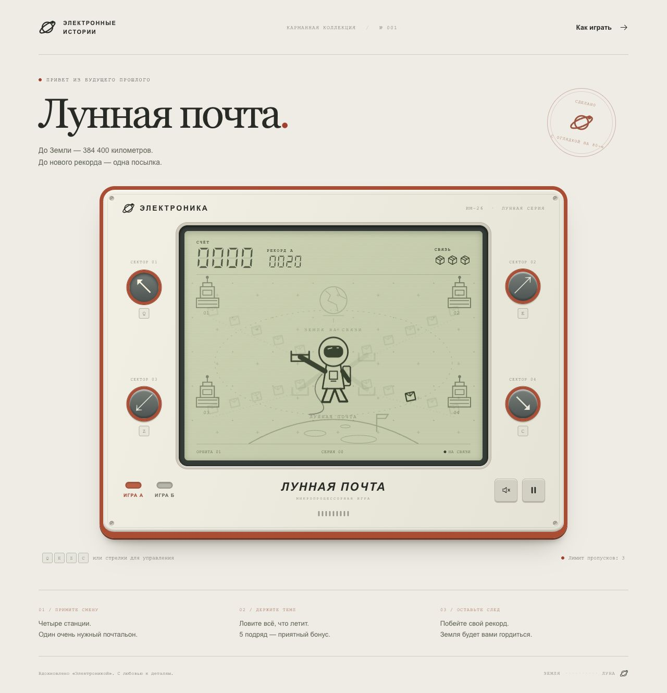

# Лунная почта

[](https://github.com/Ibragim29052003/lunar-post/actions/workflows/checks.yml)

Авторская браузерная аркада по мотивам карманных игр «Электроника». Четыре лунные станции отправляют посылки, а космонавт-почтальон перехватывает их корзиной. Ловите посылки, собирайте серии и продержитесь как можно дольше.

Проект выполнен на предоставленном бойлерплейте: **React 17, TypeScript, Webpack, LESS Modules, ESLint и Prettier**. Для тестов используются Vitest, jsdom и axe-core. Внешние сервисы и игровой сервер не нужны.



## Быстрая проверка готовой игры

[Скачайте готовую игру из релиза v1.0.0](https://github.com/Ibragim29052003/lunar-post/releases/tag/v1.0.0). В прикреплённом архиве `lunar-post.zip` уже есть папка `dist/`. После распаковки выполните из папки проекта:

```sh
npm run preview
```

Откройте **http://127.0.0.1:8080**. Для этого режима нужен только Node.js; устанавливать `node_modules`, скачивать пакеты или повторно собирать проект не требуется. Если порт занят: `npm run preview -- --port 8081`.

## Запуск для разработки

Нужны **Node.js 22.15+ (ветка 22), 24 или 26+** и npm. Для исходников из этого репозитория:

```sh
git clone https://github.com/Ibragim29052003/lunar-post.git
cd lunar-post
npm ci
npm run dev
```

Откройте **http://127.0.0.1:8080**. На Windows, macOS и Linux команды одинаковые. Порт можно изменить командой `npm run dev -- --port 8081`.

Внешняя сеть нужна при установке зависимостей. После установки графика, звук и игровой процесс работают локально. Шрифты, изображения, аналитика и API извне не загружаются.

## Управление

| Действие                                  | Клавиши          |
| ----------------------------------------- | ---------------- |
| Сразу выбрать верхний левый сектор        | Q                |
| Сразу выбрать верхний правый сектор       | E                |
| Сразу выбрать нижний левый сектор         | Z                |
| Сразу выбрать нижний правый сектор        | C                |
| Сменить высоту или сторону корзины        | Стрелки или WASD |
| Начать смену / приостановить / продолжить | Пробел           |
| Приостановить / продолжить                | P или Esc        |

Клавиши обрабатываются через `KeyboardEvent.code`, поэтому русская раскладка не мешает игре. На сфокусированной кнопке пробел выполняет её стандартное действие. Все кнопки доступны через Tab; Enter активирует выбранную кнопку.

Мышью или на телефоне нажимайте круглые кнопки с нужной стрелкой. На сенсорном экране выбор происходит уже при касании. **Корзина должна находиться в секторе в момент прибытия посылки**; нажимать повторно для каждой посылки не нужно.

## Правила

- Доставка приносит **10 очков**.
- Каждая пятая посылка подряд приносит ещё **5 бонусных очков**.
- Промах сбрасывает текущую серию и тратит одну из трёх попыток.
- После третьего промаха смена заканчивается. Экран результата показывает очки, количество доставок и лучшую серию.
- Каждые **8 доставок** скорость растёт. Есть десять уровней сложности; скорость ограничена снизу.
- **Игра А** — спокойная орбита. **Игра Б** — более быстрый экспресс. Режим выбирается до начала смены или после её завершения.
- Рекорды режимов и настройка звука сохраняются отдельно в `localStorage` текущего браузера. При недоступном хранилище игра продолжает работать, но сохранение между открытиями недоступно.

## Что реализовано

Все обязательные состояния: приветствие и запуск, игра, живой счёт, проигрыш и новая смена. Есть клавиатура, мышь и тач-управление.

Дополнительно:

- Авторский корпус с кнопками, винтами и решёткой динамика; LCD-палитра, дискретное движение посылок и следы неактивных сегментов.
- Векторные станции, космонавт, Земля и лунный пейзаж; CSS-оформление. Чужие картинки и материалы из документа в проект не включены.
- Короткие звуки синтезируются через Web Audio после действия пользователя. Первая мелодия дожидается разрешения браузера; отключение звука сразу заглушает запланированные ноты.
- Пауза по кнопке и клавиатуре, при открытии инструкции, потере фокуса окна и уходе со вкладки. Продолжение — только по действию игрока.
- Адаптивное расположение кнопок, включая экраны 320 px, видимые индикаторы фокуса, подписи для скринридера, нативное модальное окно инструкции, поддержка `prefers-reduced-motion`.
- Независимые рекорды двух режимов, серии и бонусы, постепенное повышение сложности. Рекорды синхронизируются между вкладками и не перезаписываются меньшим результатом. При недоступном хранилище интерфейс объясняет, что рекорд сохранится только в текущей странице.
- Чистый детерминированный движок, тесты правил, жизненного цикла, ввода, хранилища, звука и всего игрового интерфейса.

## Архитектура

```text
src/
  game/
    config.ts          # Баланс, режимы, сектора и подписи
    engine.ts          # Чистые переходы состояния без React и браузерных API
    useGame.ts         # Связь движка с React, клавиатурой и жизненным циклом окна
    input.ts           # Соответствие физических клавиш действиям
    storage.ts         # Проверка и сохранение локальных настроек
    audio.ts           # Синтез коротких звуков
    *.test.ts          # Юнит-тесты Vitest
  components/
    App/               # Состояния интерфейса и адаптивный корпус
    GameScene.tsx      # SVG-сцена и дискретное отображение посылок
    HelpDialog.tsx     # Инструкция в нативном dialog
    Icon.tsx           # Векторные иконки
```

Игровой цикл использует `requestAnimationFrame` и фиксированный шаг **50 мс**. Размер входящего кадра ограничен 250 мс, чтобы краткая задержка браузера не вызывала скачок времени. При паузе цикл отключается, при размонтировании обработчики и ресурсы очищаются.

Генератор с seed хранится внутри состояния: одну и ту же смену можно воспроизвести в тесте. Время полёта фиксируется при появлении посылки, поэтому повышение уровня не сдвигает уже летящие посылки. Между прибытиями остаётся не менее 500 мс; этот предел задан в конфиге. Число позиций полёта используется и движком, и графикой. Игровая логика не зависит от DOM, часов, `Math.random()` или звука.

Для настройки баланса меняйте `src/game/config.ts`: очки, жизни, длину серии, темп режимов и предел сложности. Не требуется менять компоненты.

## Команды и проверки

```sh
npm test                 # Однократный запуск юнит-тестов
npm run test:watch       # Тесты в watch-режиме
npm run typecheck        # Строгая проверка TypeScript
npm run lint             # ESLint 10 для исходников, конфигов и скриптов
npm run format:check     # Проверка Prettier
npm run format           # Автоформатирование
npm run build            # TypeScript + production-сборка Webpack в dist/
npm run preview          # Просмотр готового dist без установки зависимостей
npm run check            # Все проверки и production-сборка
```

Production-сборка создаёт хешированные имена файлов и source maps. Папку `dist/` можно раздавать любым статическим HTTP-сервером. Открывать `index.html` напрямую через `file://` не рекомендуется.

## Что изменено в бойлерплейте

- Вместо `Hello world` реализована игра, графика, управление и инструкция.
- TypeScript проверяется отдельной командой: `transpileOnly` у загрузчика сам по себе ошибок типов не обнаруживает. Включены `strict` и `noUncheckedIndexedAccess`.
- ESLint обновлён до поддерживаемой ветки 10 и переведён на flat config. Проверяются TypeScript, React Hooks, конфиги и скрипты. Prettier обновлён до ветки 3. Доступность пяти состояний проверяется axe-core в интеграционных тестах. Удалены устаревшие конфиги и неиспользуемые зависимости.
- Настроены production-режим, очистка `dist`, относительный путь ассетов, заголовок страницы и авторская favicon. Убраны неиспользуемые загрузчики и исходный логотип React.
- Добавлены команды проверок, тесты, `.gitignore` и lock-файл. Dev-сервер слушает только локальный интерфейс.
- Версии React сохранены из задания; сборщик остался Webpack. Vitest применяется только для тестов, сборка приложения не перенесена на Vite.

## Проверки на GitHub

При каждом push в `main` и в pull request GitHub Actions выполняет чистую установку зависимостей, проверку TypeScript, ESLint, Prettier, все тесты и production-сборку. Автоматизация имеет доступ только на чтение содержимого репозитория.

В Git хранятся исходники, lock-файл, скриншоты и отчёт аудита. `node_modules` и генерируемая папка `dist/` исключены через `.gitignore`; готовая сборка доступна в ZIP релиза.

## Результаты проверки

Проверено 28 октября 2026 года:

- **96 автоматических тестов** в шести файлах: 72 проверки игровых модулей, 19 сценариев интерфейса и 5 проверок доступности axe-core. Все пройдены.
- В 50 симуляциях движок обработал **9800 успешных доставок** в двух режимах без потерь жизней у идеального игрока.
- Чистая установка по lock-файлу, TypeScript, ESLint без предупреждений, Prettier и production-сборка проходят.
- Полный npm audit — **0 известных уязвимостей** на момент проверки.
- Корпус, счёт и кнопки помещаются в окно после старта на восьми проверенных размерах от 320 × 568 до 1366 × 768, включая два альбомных режима.
- Проверены загрузка готовой сборки, HTTP-методы, отсутствующие файлы, ошибки кодирования URL и защита от чтения файлов вне dist.

Подробности, исправления и границы проверки: [AUDIT.md](AUDIT.md).
